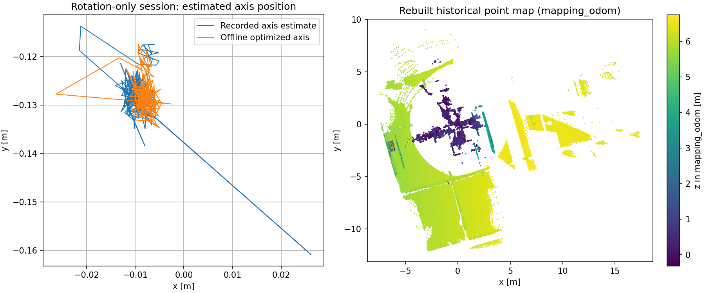

# 离线局部子图配准：实车160帧验证

基线5afb5eec17086ffff55ac78e4dac3821937c96d8；开始已检查git status并SSH fetch，远端main仍69842dd、功能分支仍5afb5ee。保留原有smoke_local_site_navigation.py修改。

## 问题确认

原离线优化器只将上一关键帧作为VGICP目标。旋转时相邻两帧扫描覆盖和采样密度不同，欧氏最近邻RMSE可能超限，不能简单当作LIO发散，也不能只因点面误差较低就豁免门限。

真实新24帧会话的9→10帧只读诊断（ASUS当时可用）显示：记录位姿下原始最近邻RMSE0.15270m、局部平面法向RMSE0.05908m；加入7、8、9三帧后，最近邻RMSE0.11690m。这只是覆盖诊断，非GICP结果、非真值、非新的准入规则。

随后ASUS SSH多次连接超时，本轮代码构建与验收转至本机WSL Ubuntu24.04/Jazzy，**未部署ASUS**。不改上一轮在ASUS运行的LIO库和现场进程。远端新24帧子图优化暂未测试。

## 修复方式

新增显式选项 `--adjacent-submap`，默认单帧模式保持不变。子图最多3个已通过配准的历史关键帧、最多5秒、参考点距离3米；每帧<=200,000点，总目标<=600,000点。源帧仍读取并验证完整档案；容量拒绝不静默截断原始关键帧。

历史帧使用此前通过门限的相对配准结果构成位姿链，统一变换至上一图节点坐标。新配准结果仍表达previous_T_current，作为相邻GTSAM因子。没有直接把未经验收的LIO位姿当作历史图对齐真值；LIO仅提供现有初值。没有改small_gicp、KISS或GTSAM算法。

保持原门限：RMSE<=0.15m、inlier_ratio>=0.6、inlier_count>=50、condition>=1e-6、相对初值平移修正<=0.5m、旋转修正<=0.3rad，及原始图后验/回环移除对照验收。没有纯里程计补边。

adjacent_edges.json增加target_mode和target_frame_ids，保留原algorithm/matrix/quality字段；日志增加修正量、目标帧数和点数。原调用命令及旧输入格式兼容，未知/重复参数拒绝。

## 实际160帧对照

本机直接解压已备份的 `rotation_keyframes_20261022.tar.gz`，包含原现场160帧，**这些是上一轮过滤修复前的原始档案**。不将其写成新LIO版本生成的地图，也不覆盖旧CDR或旧失败日志。

本机测试工作区：`/root/adam_nav_submap_20261022`。

```bash
ros2 run rm_nav_mapping offline_graph_optimizer \
  raw_session/session_1792670869656779404_3581137020 original_160
# 原模式返回1：139→140帧RMSE0.153856m，拒绝，无输出地图

ros2 run rm_nav_mapping offline_graph_optimizer \
  raw_session/session_1792670869656779404_3581137020 submap_160 \
  --adjacent-submap --enable-loops
# 返回0：完整160帧配准、回环、GTSAM后验检查及地图重建通过
```

| 指标 | 单帧139→140 | 子图139→140 |
| --- | --- | --- |
| 目标帧数/原始点数 | 1 / 17,642 | 3 / 53,721 |
| VGICP欧氏RMSE | 0.153856m | 0.140308m |
| inlier_ratio | 0.795343 | 0.868809 |
| 平移修正 | 0.070921m | 0.065783m |
| 旋转修正 | 0.041566rad | 0.041739rad |

子图完整结果：重建83,229点；图目标5.481165→0.032038、3次迭代；峰值RSS127,116KiB（约124MiB）、墙钟31.105秒、累计进程CPU622.814秒。CPU为多线程累计值，不是墙钟时间或单核占用率。

后验最大局部平移变化0.07098m、旋转变化0.04705rad；最大单帧平移修正0.06308m；移除最差回环后的最大平移变化0.000466m、旋转变化0.000678rad。接纳155条回环，主要是固定位置旋转/重复观测，不能说完成155次实车绕场闭环。



图左是记录的轴心估计与优化后轴心，图右按mapping_odom中的z着色；不是现场地面真值或可通行区域证明。

完整输出位于WSL的submap_160目录，副本见证据目录中的submap_160_artifacts.tar.gz。坐标仍mapping_odom，official_alignment_applied=false。尚无自由栅格、占据层发布或冻结地图定位验证，**不是可用于导航的正式MapBundle**。

## 测试与限制

- mapping包构建通过，8项C++测试0失败。新增测试覆盖参考变换方向及旋转、最多3帧、5秒/3米边界、非单调时间/ID和超容量拒绝。
- 实际VGICP/GTSAM受控档案回归通过：有已知运动/漂移的合成点云，子图模式位姿误差<0.10m；history IDs准确。未知/重复参数、正在录制、坏标定、非单调时间、缺帧、截断、坏位姿/原点、非重叠、partial档案在子图模式仍拒绝。保留原输入不变检查。
- 最初ROS脚本因WSL动态库路径失败，修正LD_LIBRARY_PATH并确认实际可执行文件后重跑通过。首次失败及重跑日志保留，不将环境失败当作功能通过。
- 本机完整新工作区 `/root/adam_nav_submap_full_20261022` 全14包构建通过（5分23秒），`colcon test --executor sequential --return-code-on-test-failure`和`colcon test-result --verbose`汇总65 tests、0 errors、0 failures、1 skipped；新增600k点容量测试通过。首次构建因复制时缺third_party支持文件失败，补齐原有依赖后重跑，首次日志保留。已有hardware_interface弃用警告及TDT编译警告未借机修改。
- 使用完整新安装再次运行offline smoke及KISS/GICP回环smoke通过；ASUS构建、24帧最新数据验证、现场部署均NOT TESTED。
- 没有新传感器真值。子图点较密使RMSE下降，本身不证明位姿更正确；完整后验检查仍只是一部分质量证据。
- 滚动历史子图会让相邻因子共享点，因子误差存在相关性；当前固定sigmas不是独立性/概率证明。默认模式不变，不能把图误差下降当作发布资格。
- 历史图目标最多600k点，目标复制与KD树仍增加CPU/内存。本次小场景资源可接受，不代表500帧/大场地性能已验收。
- 在线建图、LIO、控制与串口均未改。本轮只提供显式离线模式，不能把新命令直接用在活跃录制会话。

## 接下来

ASUS恢复后，先对新LIO输出的24帧会话运行同一选项，检查全链路与失败帧；通过后再用新慢转/场地行驶数据交叉验收。旧160帧成功解决了可复现的离线配准阻断，但还不能宣布整车建图导航完成。

`tools/replay_raw_mapping_pipeline.py`新增同名可选参数，以便恢复连接后从原始输入重跑；本轮只做该入口Python编译检查，未将本机160帧成功算作ASUS新24帧验证。默认仍调用单帧优化。更完整的独立复现结果及日志见 [证据目录](evidence/adjacent_submap_20261022)。
