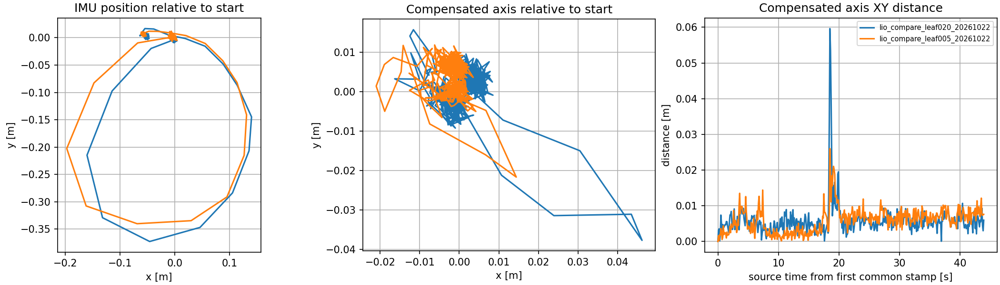

# LIO去畸变、参数与原Adam对照

本轮检查基线：`ae9151c29d91598aafd434fb91e8daaa0a259ae3`，工作分支audit-p0-tf-costmap。已执行git fetch，远端main为`69842dd76184c41a12ec0f446cdbcb9dffa1c31f`；main独有4条首页文档提交，无新增LIO实现，因此按当前功能分支与真实运行源码审查，未覆盖main。保留原有未提交的 `tools/smoke_local_site_navigation.py`。

## 结论与边界

用户此前原Adam运行正常的经验是重要对照，不能仅以“本次转得快”结束排查。本次发现一项可复现的点云发布过滤缺陷，已在ASUS独立候选库修复并验证；还发现两项逐点时间风险，尚未宣称它们已经导致本次误差。没有替换前端、没有放宽回环门限，**现场运行的LIO仍为原实例**。

原始LIO IMU点在偏心旋转时本来就应走圆弧，约38cm最大位移不能直接算作底盘漂移。应同时看补偿轴心、静态场景重合度与配准残差。离线VGICP拒绝也不能单独证明LIO位姿发散。

## 实际查阅的源码

| 本地源码 | 重点位置及作用 |
| --- | --- |
| 原Adam `point_lio/config/mid360.yaml` | 原Point-LIO参数、原厂内部外参、g单位 |
| 原Adam `point_lio/src/preprocess.cpp:104`及`:330`附近 | CustomMsg逐点offset_time、tag/line和blind过滤 |
| 原Adam `point_lio/src/IMU_Processing.cpp:87` | Process在初始化后复制原始点；不能只凭feats_undistort变量名断言这里已做完整去畸变 |
| 原Adam `point_lio/src/laserMapping.cpp:475`、`:583`、`:184` | 空间降采样、按curvature推进时序、发布feats_down_world |
| 当前固定small_point_lio `src/lidar_adapter/livox_pointcloud2.h:33` | 读取FLOAT64绝对纳秒timestamp，再乘1e-9 |
| 当前small_point_lio `src/small_point_lio/preprocess.cpp:33` | dense分支在距离检查之前收点，是此次已复现缺陷 |
| 当前small_point_lio `src/util/voxelgrid_sampling.cpp:189` | 体素内位置平均，时间却取遍历中的最后一个点 |
| 当前small_point_lio `src/small_point_lio/small_point_lio.cpp:93` | dense点用最近滤波状态变换，未单独预测到dense点时间 |
| `rose_navigation-main/config/mid360_lm.yaml`及`src/lm/small_point_lio.cpp:410` | 同类small_point_lio，配置0.01m空间叶长、0.1m地图；dense分支也有相似时序风险，不能因另一学校采用就认定正确 |
| `sentry26-main/src/rm_localization/point_lio/config/mid360.yaml` | 相同g单位/内部外参，部分IMU噪声参数不同 |
| `navi_minco_bit-master/.../Point-LIO/config/mid360.yaml` | 相同g单位/内部外参，增加2ms更新窗口；不是当前small_point_lio可直接照抄的参数 |
| `HWSentryNav26-main/.../small_glim/src/preprocess/cloud_preprocessor.cpp:123` | 保留逐点时间、排序、检查扫描时长；仅参考输入契约，未引入新SLAM前端 |

ASUS实际依赖提交为 `688d75cfa780049ae532e5100ca64f46ad8b1a93`，源码实际修改仍为原raw-state发布补丁三文件。已读取真实进程命令行、运行参数dump及依赖源码快照，不只比较README或默认YAML。

## 输入与参数核对

- 当前IMU `acc_norm=1.0`，原始加速度z均值接近0.998g；原Adam也是g单位。未发现9.81倍单位错误。
- 工厂内部T均为[-0.011,-0.02329,0.04412]m、R单位阵、extrinsic_est_en=false。15.3cm轴心补偿在LIO之后，未重复写入工厂内部外参。
- 实际运行参数中gravity=[0,0,-9.81]、fix_gravity_direction=true；初始化按真实静止加速度确定方向。不能直接照抄rose配置中的正z重力而忽略实现。
- 45秒窗口450帧原始PointCloud2、9,000帧IMU，对应10/200Hz。FLOAT64 timestamp约1.79267e18，第一帧跨度99.989ms，与当前绝对纳秒适配器一致；未发现秒/纳秒数量级混淆。
- 原Adam多处使用CustomMsg的offset_time/1e6→毫秒；当前是PointCloud2绝对纳秒→秒。两条入口不能混用配置中的时间单位字段。
- 当前LIO实际订阅 `/lio/input/cloud` 和 `/lio/input/imu`。质量门源码原样转发消息，未修改点坐标、逐点时间或IMU单位。
- 原Adam盲区0.5m、滤波叶长0.5m、point_filter_num=4；当前0.5m、0.2m、point_filter_num=1。后端结构和采样方式不同，叶长并非越小必然越准。
- 原Adam接受tag分组0x00或0x10，当前适配器要求低6位全0，返回点集合不同。尚未改tag规则，也未通过放宽过滤制造通过。

原始窗口字段/返回分布见 [检查JSON](evidence/lio_source_compare_20261022/raw_rotation_window_inspection_20261022.json)。第一帧19,968点中11,091点小于0.5m，数量不能忽略；这包括零返回和近距离点，不代表它们都应参与建图。

## 已修：稠密点云绕过距离过滤

根因：preprocess先把点加入dense_points，后面对滤波更新点才检查min/max距离。后续发布稠密点云，零XYZ也会加上外参/估计位姿，变成传感器附近的地图点。原Adam发布经过blind/采样处理后的feats_down_world，发布内容不同。

修复范围：在dense和稀疏分支之前统一检查有限坐标、有限时间及原有[0.5,30]m距离范围；保留有效点原始坐标与时间，未改滤波方程、轴心几何、串口协议。候选补丁见 [dense_range补丁](../tools/patches/small_point_lio_dense_range.patch)，它叠加在原raw_state补丁之后，**尚未接入默认bootstrap/现场环境**。

兼容影响/风险：稠密地图将不再包含0.5m内点，不能把这张LIO地图当作近距避障的唯一输入；原始雷达话题不变。历史关键帧仍含旧发布内容，不能直接宣称已被此次修复清理。此前验收说明中“核心按各点时间投影”的描述过强：时间队列归并不等于dense点已有精确时间预测，以本轮源码检查为准。

ASUS隔离目录：`/home/asus/nav_2027_vehicle_config_164/lio_review_dense_range_20261022`。原运行依赖 `/deps/install_lio` 未修改，原车导航工作区未修改。

实际测试：

- 候选 `colcon build --packages-select small_point_lio --cmake-args -DBUILD_TESTING=OFF` 通过，约33.7秒。编译器仍有上游Eigen相关警告，见build.log，未借机重构。
- `test_small_point_lio_dense_range.bash` 编译并调用真实Preprocess：零点、近点、超距点、NaN坐标/时间被拒绝，有效点坐标与时间保持，空返回扫描不添地图点。CTest 1/1通过；同一测试加载原库返回134，明确失败。
- 相同45秒原始窗口、0.2m参数回放，候选链路通过，437组位姿/点云；与基线435个共同时间戳的轴心最大变化均为5.963cm，末尾差仅约4.7e-8m。这符合“修复发布点云而非改变位姿估计”的范围，**不是定位误差已经解决**。
- 本轮没有重跑全14包colcon test；新增的是候选依赖构建、真实C++回归与三次真实原始输入回放，不能把此前64项测试当成本次重跑。

命令及完整日志保存在 [本轮证据目录](evidence/lio_source_compare_20261022)。测试源码和运行入口为 `tools/test_small_point_lio_dense_range.cpp/.bash`。

## 同一原始数据的叶长对照

从本次完整MCAP复制录包时间第270～315秒，仅含原始点云/IMU，序列化内容和原log时间不变；不回放旧位姿、TF、健康或控制消息。原包保留。使用独立Domain 211/212/213、LOCALHOST、use_sim_time和/clock，三次顺序回放，没有物理控制输出。

| 指标（414个共同源时间戳） | 0.20m | 0.05m |
| --- | --- | --- |
| 补偿轴心XY最大变化 | 5.963cm | 2.601cm |
| 末尾轴心距起点 | 0.597cm | 0.761cm |
| 重建轴心z范围 | 1.333cm | 1.785cm |
| 累计采样CPU | 3.33s | 5.30s |
| 采样峰值RSS | 约69.8MiB | 约70.2MiB |

5cm叶长降低了这一次快速旋转中的轴心瞬时偏移，但末尾/高度指标未同时变好，且消耗更多CPU。没有独立真值、不同初始化也可能产生差异，暂不写成全场地推荐配置。回放脚本的passed仅是输入输出/明确运动包络检查，不是精度或导航验收。

## 尚待修复与验证

1. 对dense点的精确时间变换做独立修复及恒定角速度几何回归，避免为改善显示而改变滤波积分。
2. 对体素平均位置与任取时间不配对的问题，用真实点代表或受限时间窗做隔离对照；不同时改多组噪声参数。
3. 用去掉零返回的新点云重建关键帧，再运行原门限离线优化。已有160帧档案不回写、不伪装为新过滤版本。
4. 慢转与本次快转、静止、平移数据交叉回归后，才决定部署哪个叶长/补丁。当前没有把0.154m配准失败改成通过。

原始完整MCAP已复制本机 `实车原始数据备份/20261022_仅云台旋转/run_20261022_200748`，MCAP大小2,654,472,600字节，与远端一致；同时备份在线检查图及18,982,034字节关键帧tar.gz。没有反复计算哈希。
